# Architecture

```mermaid
flowchart LR
  A[Allowlisted official manifest] --> I[Validate files and titles]
  P[Private local uploads] --> I
  S[Explicit synthetic fixtures] --> I
  I --> R[Preserved originals]
  I --> X[PDF / TXT / Markdown extraction]
  X --> C[Exact section parents and bounded children]
  C --> DB[(SQLite source versions, chunks and audit)]
  DB --> E[Namespace, domain, jurisdiction, date, version and review eligibility]
  E --> B[BM25]
  E --> D[Optional BGE + FAISS or NumPy]
  B --> F[Reciprocal rank fusion]
  D --> F
  F --> Q[Optional CPU cross-encoder]
  F --> V[Evidence and full context viewer]
  Q --> V
  V --> O[Optional local Ollama]
  O --> CV[Pydantic and exact citation checks]
  CV --> API[Local FastAPI and session boundaries]
  API --> UI[React research, readers and exports]
  V --> UI
```

This is one Python application, not a microservice deployment. Retrieval and provider settings are separate, so a model/laptop change does not require replacing the raw corpus or registry. A model identity change does require a new vector snapshot. The base mode imports no heavy optional provider.

Registry versions keep checksums, manual review metadata and nullable provenance/applicability. Content-identical reimports in a namespace are idempotent. An explicit `supersedes` relation excludes the previous version while retaining old citations. Deletion removes SQLite chunks; backend signatures and answer cache keys prevent using stale entries. Raw official originals are retained for traceability; private clear removes session files.

BM25 lexical snapshots contain safe-namespace tokens. Ranking fits the filtered candidate corpus so an excluded version does not influence candidate ordering. Dense search selects eligible rows before either FAISS inner-product or NumPy cosine search. RRF merges deduplicated chunk IDs with rank constant 60. Scores indicate relevance only. The optional reranker is disabled by default.

Legal chunking is heuristic, not a verified statutory parser. The extractor retains exact text, section parents, page ranges, qualifications and surrounding text. Clearly identifiable Act headings get section locators; other numbering remains a numbered paragraph. Editorial notes are not named statutory sections. Contents pages are kept for viewing but excluded from normal evidence. Mixed state-amendment parents are marked unknown and excluded under a central/state filter. Printed-page numbers stay unknown.

Embedding construction checks the actual published model tokenizer with special tokens; oversized children are resplit without losing text and keep linked parents/page provenance. Only changed child IDs need new embeddings. Writes use versioned NumPy files and an atomic manifest commit. Interrupted partial builds leave the previous usable snapshot; completed batches inside an interrupted first build are not checkpointed individually and may need recomputation.

The prompt quotes evidence as JSON data and bounds instructions, question, history, evidence and output. UTF-8 byte budgets are a conservative guard, not an exact Qwen tokenizer count. Ollama is streamed internally and validated before any generated legal claim is displayed. A bounded nonstreaming fallback is available. One process-wide generation lock prevents concurrent requests. Invalid schema/citations/quotes yield clearly labelled extracts. These controls do not establish semantic support or guarantee injection resistance.

The registry and dense snapshot signatures participate in in-memory answer cache keys together with all scope filters, namespace, settings/model, prompt version and bounded history. Displayed answers are invalidated after corpus/scope changes. Private caches remain in the owning opaque server session and no private persistent vector snapshot is created.
